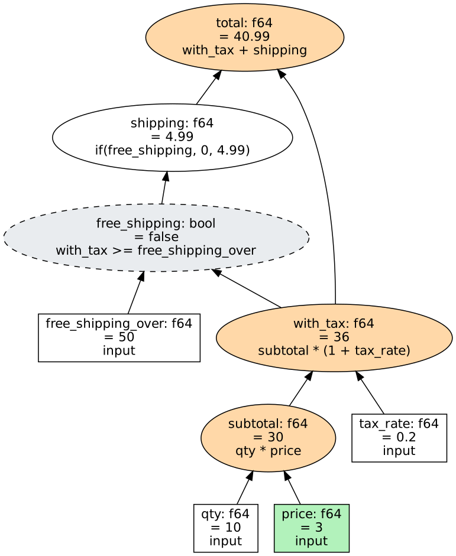

# watershed

[](https://github.com/matthewjones372/watershed/actions/workflows/ci.yml)

An incremental calculation engine, in Rust. You build a graph of inputs and
calculated nodes. When inputs change, only the nodes that depend on them are
recalculated, and an update stops spreading wherever a recalculated value comes
out the same as before.

This is the core only: one process, one thread. Distribution, parallelism,
Python and JVM bindings, and GPUs come later and build on it.

```rust
use watershed_core::prelude::*;

let mut g = Graph::new();
let qty = g.input("qty", 10.0)?;
let price = g.input("price", 2.5)?;
let tax = g.input("tax_rate", 0.2)?;

let subtotal = g.define("subtotal", qty * price)?;
let total = g.define("total", subtotal * (1.0 + tax))?;

g.set(price, 3.0)?;
g.stabilize();               // recalculates subtotal and total, nothing else
println!("{}", g.get(total)?);  // 36
println!("{}", g.explain(total));
```

A node with a condition or a choice only waits on what it actually read.
With `when(use_live).then(live).otherwise(end_of_day)`, while `use_live` is
true a change to `end_of_day` recalculates nothing; switch it, and from then
on only `end_of_day` matters. `choose(index, [a, b, c])` picks an option by
position, like a spreadsheet's `CHOOSE`, and waits only on the one it picked.
`g.reads(node)` says what a node read last time, and `explain` follows only
those.

### Collections

A collection is a keyed table of rows, with typed fields, calculated columns
and totals:

```rust
let mut orders = Collection::new(&g, "orders");
let qty = orders.field::<f64>("qty")?;
let price = orders.field::<f64>("price")?;
let line = orders.column(&mut g, "line_total", qty * price * fx)?;
let revenue = orders.sum(&mut g, "revenue", line)?;   // also count, min, max

orders.upsert(&mut g, "o-1042", &[qty.is(5.0), price.is(9.99)])?;
orders.remove(&mut g, "o-7")?;
g.stabilize();
```

Each row is a set of ordinary nodes, so changing one row recalculates that
row's columns and the totals it feeds, and nothing else: on a million rows,
16 µs and 4 nodes per changed row. Totals keep a balanced tree of partial
results, so they update by only the changed rows' paths to the root, and give
exactly, bit for bit, what adding every row up from scratch gives (a running
total that subtracted and added would drift). Removed rows are marked absent
and their nodes reused by the next new row.

```bash
cargo run --release --example collection -- 1000000
```

Totals per group follow rows as they move between groups:

```rust
let by_region = orders.group_sum(&mut g, "revenue_by_region", region, line)?;
let eu = orders.group(&g, by_region, "EU".to_string());   // a node, like any other
orders.group_keys(&g, by_region);                          // groups that have rows
```

Each group's total is a node, made when the first row with that key arrives.
When a row changes group, its old and new groups update by just that row:
on 1,000 rows in 10 groups, a move recalculates 4 nodes.

Rows can be grouped by a calculated column too. Its value is only known
during an update, so the graph watches it: as soon as a row's column has
been recalculated to a new value, the row joins that group, in the same
update. A row whose column is an error is in no group.

```rust
let size = orders.column(&mut g, "size", when(line.gt(limit)).then("large".to_string()).otherwise("small".to_string()))?;
let by_size = orders.group_sum(&mut g, "revenue_by_size", size, line)?;
```

Calculations are typed. `qty + region` (a number plus a string) does not
compile, and neither does setting a calculated node.

### Decimals

`f64` is fast and inexact: `0.1 + 0.2` is `0.30000000000000004`. For money,
and anything that has to reconcile to the last digit, a node can hold a
`Decimal` instead: up to 28 significant digits, exact, and keeping the
decimal places it was written with (`1.50` stays `1.50`).

```rust
use watershed_core::{Decimal, Rounding};

let net = g.input("net", "19.99".parse::<Decimal>()?)?;
let vat = g.input("vat", "0.20".parse::<Decimal>()?)?;
let tax = g.define("tax", (net * vat).round(2_i64))?;      // 4.00
let gross = g.define("gross", net + tax)?;                  // 23.99
```

- Adding, subtracting and multiplying are exact while the result fits. A
  result too large to hold is an error value, not a wrong number.
- Dividing rounds at the last digit the type holds; dividing by zero is an
  error value.
- `round(places)` puts a value on the places you want, a tie going to the
  even neighbour; `round_with(places, Rounding::HalfUp)` and the others say
  otherwise.
- A decimal does not mix with an `f64` or an `i64` by accident: `net * rate`
  with a float `rate` does not compile. `to_decimal()` and `to_f64()`
  convert on purpose.
- `1.5` and `1.50` are equal, but changing one to the other is passed on,
  because something above may be showing it.

Totals, groups, history, formulas as text (`19.99d`, `round(x, 2)`), Kotlin
(`BigDecimal`) and Python (`decimal.Decimal`) all take decimals. A decimal
sits behind a pointer, so every value is still 16 bytes and a graph of
floats pays nothing for them: the same instructions per recalculated node
as before. A decimal node costs about four times a float node to
recalculate (about 83 ns against 21 ns here).

### Earlier values

With history on, any node, or any row of a collection, can be read as it was
at the end of an earlier update:

```rust
g.keep_history(1_000);                      // the latest update and the 1,000 before it
g.get_at(total, 41)?;                       // `total` after update 41
orders.get_at(&g, "o-1042", line, 41)?;     // a row's column then
orders.keys_at(&g, 41)?;                    // the rows there were
g.explain_at(total, 41)?;                   // why it had that value then
```

`explain_at` is `explain` for an earlier update: the values of then, the
branch of an `if` each node took then, the members a total had then, and
`[changed]` on what that update changed. Expressions are today's: a node
given a new one by `redefine` since is shown with its value and a note. The
grid's "why this value" uses it while the grid is looking back.

An update moves each value it overwrites into a chain for that node, 32
bytes each, and a value that comes out the same is never recorded. On a
million nodes with one price changing per update, that is about 1,300
values and 43 KB per update. A collection also notes which key each
reused row held, so history follows a key as removed rows are reused.

To keep changes beyond the process, `g.attach_sink(...)` hands each
update's changes to a `ChangeSink`. `crates/watershed-parquet` is one that
writes them to Parquet files on a background thread, about 10 bytes per
change.

### Pull mode

By default an update recalculates everything that depends on what changed.
In pull mode it recalculates only what someone is watching, and what that
uses:

```rust
g.watch(total)?;
g.calculate_only_watched(true);
g.set(price, 3.0)?;
g.stabilize();              // total and what it uses; nothing else
g.get(total)?;              // up to date
g.get(elsewhere);           // an error: it is not being calculated
```

A node that is not needed and would have been recalculated is parked with
its old value, and nothing above it hears of the change. Watching more (or
turning pull mode off) brings what was parked up to date at the next update,
and passes it on from there as usual. Off, pull mode costs one test per
level of an update.

### Removing nodes

A node that nothing uses can be removed:

```rust
g.remove(scratch)?;     // refused while another node or a total uses it
```

It is no longer calculated or found, its name is free for a new node, and
reading it, setting it or using it in an expression is an error. Its id is
not handed out again, so a handle kept from before never comes to mean a
different node, and with history on it can still be read as of the updates
it was part of. Its slot in the graph stays: removing frees a node's name
and its work, not its memory. Like `redefine`, the next update rebuilds the
graph's links, so it suits edits rather than a stream of changes.

## From Python

`crates/watershed-py` is a Python package with the same engine, built with
PyO3 and managed with [uv](https://docs.astral.sh/uv/):

```python
import watershed as ws

g = ws.Graph()
qty = g.input("qty", 10.0)
price = g.input("price", 2.5)
total = g.define("total", qty * price * 1.2)
g.set(price, 3.0)
g.stabilize()
print(total.value, g.explain(total))
```

```bash
cd crates/watershed-py
uv sync && uv run pytest
```

## From Kotlin and Scala

[surefold/watershed-jvm](https://github.com/surefold/watershed-jvm) is the
engine for the JVM, with typed layers for Kotlin and Scala 3:

```kotlin
val g = Graph()
val qty = g.input("qty", 10.0)                     // Input<Double>
val price = g.input("price", 2.5)
val total = g.define("total", qty * price * 1.2)   // Node<Double>
g[price] = 3.0
g.stabilize()
val now: Double = g[total]                         // 36.0
```

It is a repository of its own, which takes this one at a pinned commit.
Updating from Kotlin or Scala is as fast as from Rust, and a call costs
tens to hundreds of nanoseconds.

## Formulas as text

For people who type a formula rather than write Rust or Python (a grid's
column, a rule in a settings file), `watershed_core::formula` turns text into
the same checked expression:

```rust
let total = g.define_formula("total", "qty * price * (1 + `tax rate`)")?;
let (line, _) = orders.add_formula_column(&mut g, "line", "qty * price * fx")?;
```

```python
net = g.define("net", g.formula("qty * price * (1 - discount)"))
line = orders.column("line", orders.formula("qty * price * fx"))
```

It has `+ - * /`, comparisons, `&&`, `||`, `!`, `if(c, a, b)`, `min`, `max`,
`abs`, `text`, `concat`, `join`, `choose` and lists of strings. A name is a
node (in a collection, a field or column first); a name with spaces or
punctuation goes between backticks. A number is an `f64`, unless it ends in
`d` (`19.99d`, a decimal) or `i` (`3i`, a whole number, an `i64`). The grid's
formula box uses the same parser.

Calling from Python adds little: on a 210,000-node graph, changing one price
and updating takes about 29 µs from Python.

## Build files

[wsb](https://github.com/surefold/wsb) is a typed build file language for
JVM projects (Kotlin first), built on this engine, in a repository of its
own. Every value in a build file is a node, so saving an edit works out only
what it changes, and any value can say where it came from.

A node's formula can be changed after it is made: `g.redefine(node, expr)`.
Like `set`, it takes effect at the next update, which recalculates the node
and whatever its new value reaches.

## Try it in your browser

`web/` is an interactive page running the real engine, compiled to
WebAssembly: move inputs and watch only the dependent nodes recalculate, ask
any node why it has its value, and time a graph of up to a million nodes on
your own machine.

```bash
cargo install wasm-bindgen-cli --version 0.2.130   # once
rustup target add wasm32-unknown-unknown            # once
web/build.sh
python3 -m http.server -d web/dist 8000             # then open http://localhost:8000
```

## A data grid

`crates/watershed-grid` is a data grid on the engine, compiled to
WebAssembly: `web/build.sh` also builds it. It is the "Data grid" tab of
the page above (http://localhost:8000/#grid), and a page of its own at
http://localhost:8000/grid/.

Rows are a collection, so every cell is a node. Calculated columns are
formulas typed as text (`qty * (mark - price)`, `if(side == "Buy", 1, -1)`),
and the totals in the bottom row and in each group's row are aggregates.
Editing a cell recalculates that row's formulas and the totals they feed: on
100,000 rows, a handful of nodes out of 1.1 million. Filtering (`>100`, `5..10`, `=Rates`),
sorting by several columns and grouping happen in Rust too; the page asks
only for the lines in view and draws those, so 100,000 rows scroll like 50.
A stream of 100 price changes per frame takes about 1 ms to apply and
redraw. The view is left alone unless a change touches a column it reads,
and then only the rows that were set are moved to where they now sort:
sorted by a calculated column, the same stream takes about 2 ms. It is
filtered and sorted from scratch only when that would be quicker (many rows
set at once) or everything may have moved (a named value changed).

```js
import init, { Grid } from "./pkg/watershed_grid.js";
import { WatershedGrid } from "./grid.js";

await init();
const grid = new Grid();
grid.add_field("region", "text", "none");
grid.add_field("qty", "number", "sum");
grid.add_field("price", "number", "none");
grid.add_formula("line", "qty * price", "sum");
grid.upsert("o-1", ["EU", "2", "10"]);

const view = new WatershedGrid(document.querySelector("#grid"), grid);
grid.set_cell("o-1", 1, "5");
view.refresh();                 // recalculates o-1's line and two totals
grid.explain("o-1", 3);         // why line is 50
```

Totals are a sum, average, minimum, maximum or count. With
`grid.keep_history(120)`, a column can draw how each cell, group total and
total moved over the last updates beside its number: the engine already
keeps the values an update overwrites, so the grid stores nothing extra.
`web/grid/chart.js` draws each group's total as a bar, straight from the
group nodes, so it follows a stream of prices without adding anything up.

Columns can be dragged into a new order (the column moves as it is
dragged, and dragging it onto the pinned columns pins it), pinned to the
left, hidden and resized, from each header and its menu. Rows can arrive as the person
scrolls: give the view a `loadMore` function that adds the next block and
says whether there may be more. Rows loaded that way are ordinary rows, so
sorting, filters and totals cover everything loaded so far.

With history kept, `grid.set_as_of(update)` shows the whole grid as it was
after an earlier update: cells, totals, which rows pass the filters and
their order. Nothing can be changed until it is back at now.

A text column's filter can name several values (`=Rates|FX`); the column's
menu lists its values to tick.

Edits can be undone and done again (a paste is one step), a column's total
can be changed from its menu, and cells copy and paste as tab-separated
text, to and from a spreadsheet. Dragging over cells, or Shift with the
arrow keys, picks out a block: it copies, takes a paste, fills with one
value, and the page shows its count, sum, average, least and greatest,
kept current as prices move. The grid names its rows, cells and headers for
a screen reader and says what is in the cell the focus moves to.

The grid has themes: `new WatershedGrid(el, grid, { theme: "dark" })`, or
`view.setTheme("paper")` later. `WatershedGrid.themes` lists them (light,
dark, paper, dusk, terminal, high contrast), and the page has a list to pick
from. With none, the grid takes the page's colours. A theme is one rule in
`web/grid/grid.css` that sets the grid's `--wg-` colours, fonts and corners,
so one of your own is one more rule, `[data-wg-theme="mine"] { ... }`.

While a filter is on, totals are of the rows that pass it, added up the
plain way; the graph's totals are of every row.

Rows group by any text column: a field, or a formula such as
`if(line >= 100, "big", "small")`, where a row changes group as its cells
change. Group totals are aggregates in the graph only for small tables. A grouping
in the graph costs a node for each row in each totalled column, for every
column ever grouped by, and nodes cannot be removed: 50,000 rows with six
totals took about 175 MB per grouping column. Past 100,000 row-and-column
pairs (`set_group_budget`), the grid adds each group's totals up over its
rows instead, which adds nothing to the graph. Sharing one membership node
per row between a column's groupings, in the engine, would bring the cost
down enough to lift this.

## Seeing what it does

```bash
cargo run --example tour
```

builds a small graph, changes an input, and prints:

- `describe()`: every node, level by level, marking what the update
  recalculated (`*`) and what changed (`!`)
- `explain(node)`: why a node has its value, as a tree of what it uses
- `to_dot()`: a picture of the graph, drawn with Graphviz



Green: the input that changed. Orange: recalculated, and the value changed.
Grey dashed: recalculated, but the value came out the same, so the update
stopped there and `shipping` was never touched.

## How to check this is correct (without reading Rust)

You don't need to read the engine to trust it. You need to know that the tests
check the right things, and that they would notice if the engine were wrong.

### 1. Run the tests

```bash
cargo test
```

Every line should say `ok`. There are four kinds of test:

| Where | What it checks |
|---|---|
| `crates/watershed-core/tests/behaviour.rs` | 44 tests, each one promise, named as a sentence: `only_nodes_that_depend_on_a_change_are_recalculated`, `an_update_stops_where_a_value_comes_out_the_same`, `a_node_reached_by_two_paths_is_recalculated_once_and_never_sees_half_an_update`, … Read the names: they are the specification. |
| `crates/watershed-core/tests/properties.rs` | Builds thousands of random graphs (with awkward values: NaN, infinity, integer overflow, failed inputs), applies random updates, and after every update checks the rules below. |
| `src/lib.rs` (doc examples) | The example above runs, and two examples that must *not* compile (number + string, setting a calculated node) are checked to fail. |

### 2. The rules the random tests check after every update

1. **Same answer as starting from scratch.** Every value reached by incremental
   updates is identical to recalculating the whole graph from nothing. This is
   the definition of correct, and the from-scratch version is a simple loop
   that is easy to trust.
2. **Nothing recalculated twice** in one update.
3. **Exactly the right nodes recalculated.** A node is recalculated if and only
   if something it uses changed. Not one more (wasted work), not one fewer
   (a stale value).
4. **Inputs are never recalculated**, and the update's report adds up.
5. **Order is right.** A node is only recalculated after everything it uses.

### 3. Proof the tests would catch mistakes

A test suite that always passes proves nothing unless it fails when the code
is wrong. These deliberate bugs were each put into the engine, one at a time,
and the tests failed every time:

| Deliberate bug | Caught |
|---|---|
| No cutoff: always pass an update upward, even when a value is unchanged | ✅ |
| Forget to pass an update upward when a value does change | ✅ |
| Recalculate the highest nodes first instead of the lowest | ✅ |
| Never clear a node's "needs recalculating" flag | ✅ |
| Treat setting an input to its current value as a change | ✅ |
| Work out a node's level from its first input instead of its highest | ✅ |
| Let the type checker accept `&&` on numbers | ✅ |
| Compare floats with `==` for cutoff (so NaN never equals NaN) | ✅ |
| Evaluate the wrong branch of an `if` | ✅ |
| Forget to recalculate a node given a new formula by `redefine` | ✅ |
| Skip a redefined node with an `if` because what it read under its old formula did not change | ✅ |
| Copy a column's node to a new row still reading the first row's fields | ✅ |
| When many rows change at once, rebuild only the lower half of a total's partial results | ✅ |
| Never move a row whose calculated group changed during an update | ✅ |
| Count a row that joins a group during an update from the next update instead | ✅ |
| Leave the links to a removed node in place | ✅ |
| Remove a node that something still uses | ✅ |
| Treat a decimal written differently (`1.50` for `1.5`) as no change | ✅ |
| Round a tie away from zero when the even neighbour was asked for | ✅ |
| In pull mode, skip a woken node because what it read did not change in this update | ✅ |
| In pull mode, watch a node without what it uses | ✅ |
| Explain an earlier update by the branch of an `if` that was not taken then | ✅ |
| Explain a total as of an earlier update with members that joined later | ✅ |

### 4. Ask for a second opinion

To have the code reviewed independently, ask a reviewer (a person, or a
separate AI session) to check it *without* telling them it is correct. Point
them at `src/graph.rs` (the update loop is `stabilize`) and the five rules
above.

## Speed

```bash
cargo run --release --example benchmark
```

On a graph shaped like a real workload (10,000 market prices → trades → a
tree of totals), on a 4-core machine, median of many runs:

| about 1,000,000 nodes | 1 core | 4 cores | nodes recalculated |
|---|---|---|---|
| recalculate everything | 18 ms | 9.6 ms | 1,000,000 |
| one price changes | 0.13 ms | 0.13 ms | ~1,300 |
| 1% of prices change together | 5.3 ms | 5.5 ms | ~68,000 |
| 10% of prices change together | 16 ms | 15 ms | ~353,000 |

It scales to very large graphs, at about 170–210 bytes per node:

| nodes | peak memory | build | recalculate everything (4 cores) | one price changes |
|---|---|---|---|---|
| 1,000,000 | 213 MB | 0.7 s | 9.6 ms | 0.13 ms |
| 10,000,000 | 1.8 GB | 10 s | 93 ms | 2.5 ms |
| 50,000,000 | 9.9 GB | 57 s | 462 ms | 14 ms |

(One price changing costs more in bigger graphs because each of the 10,000
prices then feeds more trades.)

```bash
cargo run --release --example benchmark -- 25000000   # 25 million trades, ~50 million nodes
```

How it is fast and small:

- **Expressions are compiled** to a flat list of instructions chosen for the
  exact types involved. Pure `f64` arithmetic, the most common case, gets
  8-byte instructions that work on raw numbers, stored back to back for
  every node in one array.
- **No per-node heap allocations** for ordinary nodes: values, a packed
  16-byte record per node, names (one shared string) and the links between
  nodes (linked lists in flat arrays) all live in a few large arrays.
  Expressions are not stored; `explain` rebuilds them from the compiled code.
- **Passing an update on reads one array.** Each node's users are packed back
  to back, and each link carries its user's level, so queuing the users of a
  changed node is one sweep through memory. (Links added since the last pack
  wait in a small side list; the graph repacks once that list reaches a
  quarter of the packed links.) A user reached through several changed nodes
  is queued several times, and the repeats are removed when its level is
  sorted.
- **Levels are processed in node-id order**, which reads memory roughly front
  to back. Nodes are stored in the order they are made, so that order
  matters: `cargo run --release --example placement` builds the same graph
  level by level and subtree by subtree (each subtotal straight after the
  two it adds up). Level by level, 1% and 10% of prices changing together
  update about 2.5 to 3 times faster; one price changing takes the same
  either way.
- **Large levels run on all cores** (the `parallel` feature, on by default).
  Nodes on one level never use each other, so they are recalculated at once,
  and their users are queued from all cores too.
  Below about 30,000 nodes a level stays on one core: the threads would spend
  longer waiting for each other than working. So parallelism speeds up
  recalculating everything, but small and medium updates, which mostly wait
  on memory, do not gain from it.
- The simple tree-walking evaluator is kept as the reference: the tests check
  the compiled code against it after every update, and check that rebuilding
  an expression from its compiled code gives back exactly what was compiled.

## Layout

```
crates/watershed-core/
  src/value.rs    the value types (f64, i64, decimal, bool, string, list, error)
  src/decimal.rs  exact decimal numbers and how they round
  src/ir.rs       expressions as data, the type checker and the reference evaluator
  src/compile.rs  compiles expressions to fast instructions
  src/expr.rs     the typed Rust front end: + - * /, comparisons, when/then/otherwise
  src/formula.rs  formulas written as text, parsed into expressions
  src/handle.rs   typed handles to nodes (Input<T>, Node<T>)
  src/graph.rs    the graph and the incremental update (stabilize)
  src/aggregate.rs  totals over many nodes, kept as a tree of partial results
  src/collection.rs keyed tables of rows with columns and totals
  src/history.rs  values overwritten by updates, for reading earlier ones
  src/sink.rs     passing each update's changes outside the graph
  src/error.rs    errors
  tests/          behaviour and property tests
  examples/       tour, benchmark, collection and placement
crates/watershed-py/    the engine as a Python package (PyO3, maturin, uv)
crates/watershed-web/   the engine as WebAssembly, with three example models
crates/watershed-parquet/ an update's changes written to Parquet files
crates/watershed-grid/  a data grid as WebAssembly: rows, formulas, totals, filter, sort, group
web/                    the interactive page and its build script
web/grid/               the grid's page, the script that draws it, and the chart of group totals
```

## Not done yet

- **Speed:** small and medium updates are limited by waiting on memory.
  Placing nodes that change together near each other was the guess here,
  and the `placement` example says otherwise: what helps is each level's
  nodes sitting together, which is what building level by level gives. A
  graph built in another order could be renumbered into that one, but only
  if node ids were allowed to move (today a handle holds the id). Building
  is about 1 µs per node.
- **Collections:** a grid grouped by a formula column works its view out
  again after every edit, where one grouped by a field moves only the rows
  that were set. A million rows of four nodes each build and total in under
  two seconds, about 0.45 µs per node.
- **Reusing removed nodes' memory**: a removed node keeps its slot, and a
  removed row of a collection keeps its membership nodes.
- **Pull mode:** what a collection's groupings are built on is always
  calculated, watched or not.
- **More time travel:** restoring an earlier update, a redefined node's
  earlier expressions (so `explain_at` can go back past a `redefine`), a
  collection's groups as of an earlier update, and a sink that writes to S3.
- **Decimals in the grid:** it has no decimal columns yet. Decimals hold
  28 digits; nothing holds more.
- **Bindings:** the Python package is not published, and there is no
  cluster. (The JVM ones are in their own repository, with their own list.)
