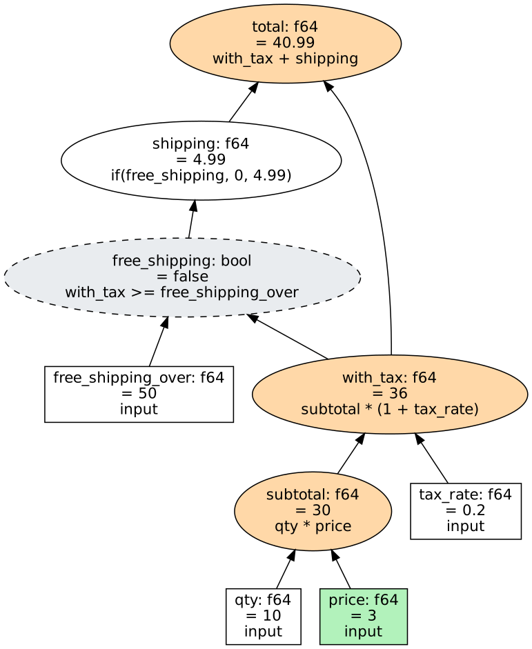

# watershed-core

The engine: a persistent dependency graph of inputs and calculated nodes,
with incremental recomputation. This file is the guide to its features. The
[top-level README](../../README.md) has the overview and the quick start;
`cargo doc --open -p watershed-core` has the API reference.

Contents:

- [The update model](#the-update-model)
- [Conditions and choices](#conditions-and-choices)
- [Collections](#collections)
- [Grouping](#grouping)
- [Exact decimals](#exact-decimals)
- [History and change tracking](#history-and-change-tracking)
- [Pull mode](#pull-mode)
- [Redefining and removing nodes](#redefining-and-removing-nodes)
- [Formulas as text](#formulas-as-text)
- [Inspecting a graph](#inspecting-a-graph)
- [Cargo features](#cargo-features)
- [Examples](#examples)

The snippets below are fragments: they assume `use watershed_core::prelude::*;`,
a `Graph` called `g`, and a function that returns `Result<_, CalcError>`.
Complete programs are in [`examples/`](examples) and in the doc examples in
[`src/lib.rs`](src/lib.rs) and [`src/collection.rs`](src/collection.rs).

## The update model

```rust
let mut g = Graph::new();
let qty = g.input("qty", 10.0)?;            // Input<f64>
let price = g.input("price", 2.5)?;
let subtotal = g.define("subtotal", qty * price)?;   // Node<f64>

g.set(price, 3.0)?;          // recorded, not yet applied
let report = g.stabilize();  // applies pending changes and recalculates
g.get(subtotal)?;            // 30.0
```

`set` records a change. `stabilize` applies every pending change and
recalculates in height order: a node's height is one more than the highest
node it uses, and heights are processed lowest first, so a node is
recalculated once, after everything it uses. Only nodes reachable from a
changed input are visited. If a recalculated value is the same as before,
its users are not queued (early cutoff). Setting an input to the value it
already has is not a change.

`Report` says how many nodes were recalculated and how many changed.

Values are `f64`, `i64`, `Decimal`, `bool`, strings, lists of strings, or an
error value. Expressions are typed in Rust: `qty + region` with a string
`region` does not compile, and neither does `g.set` on a calculated node.
Failures inside a calculation (integer overflow, a decimal too large,
division of a decimal by zero) produce an error value in that node, which
the nodes above it carry, and do not abort the update.

## Conditions and choices

A node with a condition depends only on what it read at its last
recalculation:

```rust
let quote = g.define("quote", when(use_live).then(live).otherwise(end_of_day))?;
```

While `use_live` is true, a change to `end_of_day` recalculates nothing.
After `use_live` changes, only `end_of_day` matters. `choose(index, [a, b, c])`
selects an option by position and likewise depends only on the one selected.
`g.reads(node)` returns what a node read last time, and `explain` follows
only those.

## Collections

A collection is a keyed table of rows with typed fields, calculated columns
and totals:

```rust
let mut orders = Collection::new(&g, "orders");
let qty = orders.field::<f64>("qty")?;
let price = orders.field::<f64>("price")?;
let line = orders.column(&mut g, "line_total", qty * price * fx)?;
let revenue = orders.sum(&mut g, "revenue", line)?;   // also count, min, max

orders.upsert(&mut g, "o-1042", &[qty.is(5.0), price.is(9.99)])?;
orders.remove(&mut g, "o-7")?;
g.stabilize();
```

Each row is a set of ordinary nodes: an input per field, a node per column
and a `bool` input saying whether the row is present. Changing one row
recalculates that row's columns and the totals they feed. In the
`collection` example with a million rows, that is 4 nodes per changed row
(see [benchmarks](../../docs/benchmarks.md#collections)).

Totals are aggregates that keep a balanced tree of partial results. A change
updates the path from each changed row to the root, and the result is
bit-identical to adding every row from scratch; a running total that
subtracted and added would drift in floating point.

A removed row is marked absent and its nodes are reused by the next new
row, so a collection's graph grows to its largest size and no further. (A
row's group membership nodes are the exception; see below.)

## Grouping

Totals per group follow rows as they move between groups:

```rust
let by_region = orders.group_sum(&mut g, "revenue_by_region", region, line)?;
let eu = orders.group(&g, by_region, "EU".to_string());   // a node, like any other
orders.group_keys(&g, by_region);                          // groups that have rows
```

`group_min`, `group_max` and `group_count` work the same way. Each group's
total is a node, created when the first row with that key arrives. When a
row changes group, its old and new groups each update by that one row.

The grouping key can be a calculated column. Its value is known only during
an update, so the graph watches those key nodes: once the level a changed
key is on has been recalculated, the row joins its new group, and the same
update counts it there. A row whose key is an error value is in no group.

```rust
let size = orders.column(
    &mut g,
    "size",
    when(line.gt(limit)).then("large".to_string()).otherwise("small".to_string()),
)?;
let by_size = orders.group_sum(&mut g, "revenue_by_size", size, line)?;
```

Cost: a row has one `bool` membership node for each group it has ever been
in, per grouping, and these are kept when the row leaves the group or is
removed. A grouping over many rows and many totalled columns is therefore
expensive in memory; the [grid](../watershed-grid/README.md#grouping) falls
back to summing groups outside the graph above a size budget for this
reason. Nodes a grouping is built on cannot be removed, and in pull mode
they are always calculated.

## Exact decimals

`f64` is fast and inexact (`0.1 + 0.2` is `0.30000000000000004`). A node can
hold a `Decimal` instead: up to 28 significant digits, exact, and keeping
the scale it was written with (`1.50` stays `1.50`).

```rust
use watershed_core::{Decimal, Rounding};

let net = g.input("net", "19.99".parse::<Decimal>()?)?;
let vat = g.input("vat", "0.20".parse::<Decimal>()?)?;
let tax = g.define("tax", (net * vat).round(2_i64))?;      // 4.00
let gross = g.define("gross", net + tax)?;                  // 23.99
```

- Addition, subtraction and multiplication are exact while the result fits.
  A result too large to hold is an error value, not a wrong number.
- Division rounds at the last digit the type holds. Division by zero is an
  error value.
- `round(places)` rounds half to even. `round_with(places, Rounding::HalfUp)`
  and the other modes are available.
- Decimals do not mix implicitly with `f64` or `i64`: `net * rate` with a
  float `rate` does not compile. `to_decimal()` and `to_f64()` convert
  explicitly.
- `1.5` and `1.50` compare equal, but a change from one to the other is
  propagated, because something downstream may display it.

Totals, groups, history and text formulas (`19.99d`, `round(x, 2)`) accept
decimals, and the Python bindings map them to `decimal.Decimal`. A decimal
is stored behind a pointer, so every value is still 16 bytes and a graph of
floats pays nothing for the feature. Recalculating a decimal node costs
roughly four times a float node.

Not supported: more than 28 digits, and decimal columns in the grid.

## History and change tracking

With history on, any node or collection row can be read as it was at the end
of an earlier update:

```rust
g.keep_history(1_000);                      // the latest update and the 1,000 before it
g.get_at(total, 41)?;                       // `total` after update 41
orders.get_at(&g, "o-1042", line, 41)?;     // a row's column then
orders.keys_at(&g, 41)?;                    // the rows that existed
g.explain_at(total, 41)?;                   // why it had that value then
```

`explain_at` is `explain` for an earlier update: the values, the branch each
condition took and the members each total had at that update, with
`[changed]` on what that update changed. Expressions are the current ones: a
node that has been given a new expression by `redefine` since is shown with
its value and a note.

An update moves each value it overwrites into a chain for that node, 32
bytes each. A recalculated value that is unchanged is not recorded. The
`history` example measures the cost on a million-node graph. With history
on, a collection also records which key each reused row held, so a key can
be followed across row reuse.

To keep changes beyond the process, `g.attach_sink(...)` passes each
update's changes to a `ChangeSink`.
[`watershed-parquet`](../watershed-parquet) is a sink that writes them to
Parquet files on a background thread; its crate documentation describes the
file layout, and its `cost` example measures the size per change.

Not supported: restoring a graph to an earlier update, a redefined node's
earlier expressions, a collection's groups as of an earlier update, and
sinks for object stores.

## Pull mode

By default an update recalculates everything that depends on what changed.
In pull mode it recalculates only watched nodes and what they use:

```rust
g.watch(total)?;
g.calculate_only_watched(true);
g.set(price, 3.0)?;
g.stabilize();              // total and what it uses; nothing else
g.get(total)?;              // up to date
g.get(elsewhere);           // an error: it is not being calculated
```

A node that is not needed and would have been recalculated is parked with
its old value, and nothing above it is notified. Watching more nodes, or
turning pull mode off, brings parked nodes up to date at the next update and
propagates from there as usual. With pull mode off, the feature costs one
test per level of an update.

## Redefining and removing nodes

`g.redefine(node, expr)` gives a calculated node a new expression. Like
`set`, it takes effect at the next update, which recalculates the node and
whatever its new value reaches.

A node that nothing uses can be removed:

```rust
g.remove(scratch)?;     // refused while another node or a total uses it
```

After removal the node is not calculated, `find` does not return it, its
name is free for a new node, and reading it, setting it or using it in an
expression is an error. Its id is never reissued, so a handle kept from
before cannot come to refer to a different node, and with history on it can
still be read as of the updates it was part of.

Removal frees the node's name and its work, not its memory: the slot stays
in the graph's arrays. Both `redefine` and `remove` cause the next update to
rebuild the graph's reverse links, which takes time proportional to the size
of the graph (any number of edits before one update cost one rebuild). They
suit model edits, not a stream of changes.

## Formulas as text

`watershed_core::formula` parses text into the same type-checked expression
the Rust API builds, for formulas that come from a user or a configuration
file:

```rust
let total = g.define_formula("total", "qty * price * (1 + `tax rate`)")?;
let (line, _) = orders.add_formula_column(&mut g, "line", "qty * price * fx")?;
```

The language has `+ - * /`, comparisons, `&&`, `||`, `!`, `if(c, a, b)`,
`min`, `max`, `abs`, `exp`, `ln`, `sqrt`, `pow`, `round`, `text`, `concat`,
`join`, `choose` and lists of strings. A name refers to a node (in a
collection, a field or column first). A name with spaces or punctuation
goes between backticks. A number literal is an `f64` unless it ends in `d`
(`19.99d`, a decimal) or `i` (`3i`, an `i64`). The grid's formula box and
the Python `formula` methods use the same parser.

## Inspecting a graph

```bash
cargo run --example tour
```

builds a small graph, changes an input, and prints:

- `describe()`: every node, level by level, marking what the update
  recalculated (`*`) and what changed (`!`).
- `explain(node)`: why a node has its value, as a tree of what it read.
- `to_dot()`: the graph in Graphviz format.



Green is the input that changed. Orange nodes were recalculated and changed.
The grey dashed node was recalculated to the same value, so propagation
stopped there and `shipping` was never visited.

`check_consistency()` verifies the graph's internal invariants, and
`recalculate_everything()` recalculates from scratch; the tests use both.

## Cargo features

| Feature | Default | Effect |
|---|---|---|
| `parallel` | on | Recalculates large levels of an update on all cores, with rayon. A level smaller than 32,768 nodes stays on one thread (`Graph::set_parallel_threshold`). Turn it off for WebAssembly. |

The crate forbids `unsafe`.

## Examples

```bash
cargo run --example tour                              # describe, explain, to_dot
cargo run --release --example benchmark               # incremental against full recalculation
cargo run --release --example collection -- 1000000   # a million-row collection
cargo run --release --example history                 # what keeping history costs
cargo run --release --example placement               # effect of node order on update time
```

Results and how to read them are in
[docs/benchmarks.md](../../docs/benchmarks.md). The implementation is
described in [docs/internals.md](../../docs/internals.md), and the tests in
[docs/testing.md](../../docs/testing.md).
